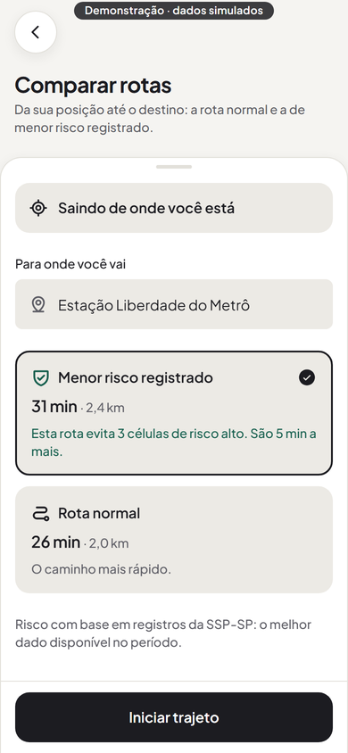
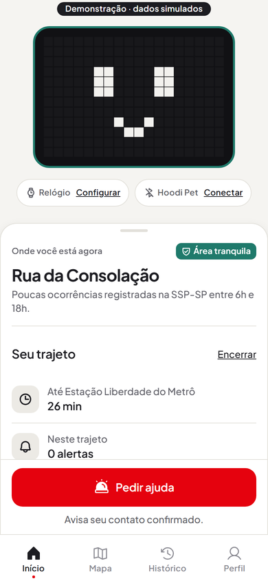
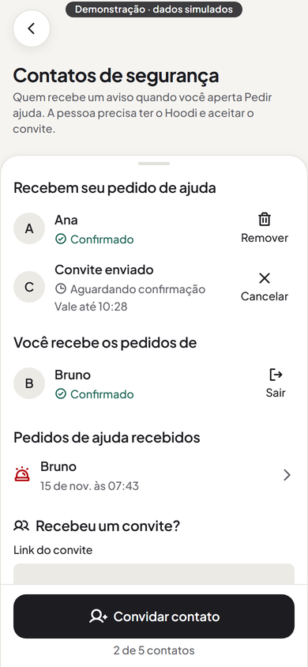
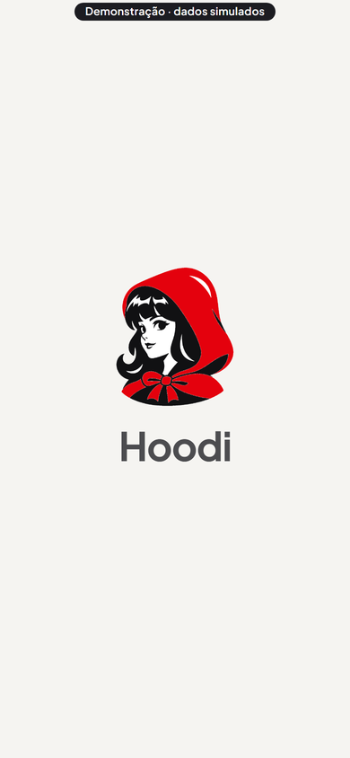

<p align="center">
  
</p>

<h1 align="center">Hoodi</h1>

<p align="center">
  <strong>Alerta de risco sem tirar o celular do bolso.</strong><br />
</p>


**Sumário:** [Integrantes](#integrantes) · [Documentação](#documentação) · [Tecnologias](#tecnologias) · [Ficha](#ficha-da-citizentech) · [ODS](#ods) · [Vídeo](#vídeo) · [Para avaliar](#para-avaliar) · [Prints](#prints) · [Como rodar](#como-rodar)

## Integrantes

| Nome | RM |
|---|---|
| Abner de Paiva Barbosa | RM558468 |
| Beatriz Vieira de Novais | RM554746 |
| Fernando Luiz Silva Antonio | RM555201 |
| Mariana Neugebauer Dourado | RM550494 |

## Documentação

| Documento | O que tem |
|---|---|
| [Funcionalidades](docs/funcionalidades.md) | Cada tela e feature (F01 a F10), com os critérios de aceite que atende |
| [Integrações](docs/integracoes.md) | API local, modo demonstração, grade de risco, protocolo Bluetooth do Pet e development build |
| [Design e acessibilidade](docs/design-e-acessibilidade.md) | Como o app segue o design system v3, ícone e splash, acessibilidade |
| [Para desenvolver](docs/desenvolvimento.md) | Estrutura de pastas, banco local e como contribuir |
| [prompts.md](prompts.md) | Registro do uso de IA (regra da GS) |

## Tecnologias

| Para quê | Biblioteca |
|---|---|
| Base | Expo SDK 58 · React Native 0.88 · TypeScript (modo estrito) · Expo Router |
| Dados no aparelho | `expo-sqlite` (grade de risco, histórico, preferências) · `expo-secure-store` (sessão) |
| API | `fetch` com renovação automática do login ([`sessao.ts`](src/features/conta/sessao.ts)) |
| Mapa e posição | `react-native-maps` · `expo-location` |
| Avisos | `expo-notifications` (espelhada no relógio) · `react-native-ble-plx` (Hoodi Pet, protocolo v1) |
| Interface | Plus Jakarta Sans · Phosphor Icons · `react-native-svg` · Lottie · `@react-native-community/datetimepicker` |

## Ficha da CitizenTech

| Campo | Resposta |
|---|---|
| **Nome** | Hoodi |
| **Cidade e bairro** | São Paulo · entorno da FIAP Paulista (Paulista, Bela Vista e Liberdade) |
| **Cidadão beneficiado** | Estudante do noturno, de 18 a 30 anos, que anda a pé da faculdade até o metrô ou até em casa |
| **Problema, em uma frase** | Caminhar sozinho à noite é inseguro, e tirar o celular do bolso na rua para checar o caminho é justamente o que a pessoa quer evitar |
| **Como funciona** | O app guarda no celular a grade de risco feita com dados da SSP-SP, cruza a posição com a célula e o horário e, quando o risco sobe, avisa pelo relógio (notificação) e pelo Hoodi Pet (vibração e carinha). Também compara rotas pelo menor risco registrado e avisa contatos de confiança no Pedir ajuda |
| **O que cada parte faz** | **App (este repositório):** a interface do cidadão · **API .NET:** contas, contatos, pedido de ajuda e rotas · **ML:** a grade de risco · **Hoodi Pet (ESP32):** o alerta no bolso · **Infra Linux:** hospeda a API |
| **Repositório** | https://github.com/NeugeMa/hoodi |
| **Indicador de impacto** | **% de trajetos feitos pela rota de menor risco registrado** (medido pelo app, no Comparar rotas) e **sensação de segurança antes e depois** (pesquisa de 1 a 5 com estudantes do noturno da FIAP Paulista) |
| **ODS conectados** | **11** (meta 11.7), **16** (16.1), **5** (5.2) e **4** (4.a): veja [ODS](#ods) |

## ODS

| ODS | Meta | Como o Hoodi contribui |
|---|---|---|
| **11 · Cidades e comunidades sustentáveis** (principal) | 11.7: espaços públicos seguros e inclusivos | Ajuda quem anda a pé até o metrô a escolher caminhos com menor risco registrado e avisa no trajeto, pelo relógio e pelo Hoodi Pet |
| **16 · Paz, justiça e instituições eficazes** | 16.1: reduzir todas as formas de violência | Usa dados públicos da SSP-SP para prevenção: evitar áreas com mais ocorrências e avisar contatos de confiança no Pedir ajuda |
| **5 · Igualdade de gênero** | 5.2: eliminar a violência contra mulheres e meninas nos espaços públicos | Quem mais teme andar sozinha à noite são as mulheres; o alerta discreto e o pedido de ajuda respondem a esse medo |
| **4 · Educação de qualidade** | 4.a: ambientes de aprendizagem seguros | O cidadão é o estudante do noturno: o trajeto até a faculdade faz parte de estudar com segurança |

## Vídeo

**App rodando (até 3 min):** _link a adicionar_

## Para avaliar

Dá para usar o app inteiro **sem subir a API**, no **modo demonstração**: ele já vem com uma conta de teste e dados simulados.

| | |
|---|---|
| **E-mail** | `demo@hoodi.dev` |
| **Senha** | `Teste@2026` |

Na tela **Entrar**, o botão **Preencher** coloca os dois.

**No navegador (o jeito mais rápido):**

```bash
npm install
npx expo start --web --port 8081
```

Abra **http://localhost:8081/?demo=1**. O modo fica ligado nesse navegador até você abrir `?demo=0`.

**No celular, com o Expo Go:** crie o arquivo `.env` na raiz com `EXPO_PUBLIC_DEMO=1`, rode `npm start` e leia o QR code.

**Roteiro sugerido (cerca de 2 minutos):**

1. Abra o app: a abertura mostra a logo e o nome Hoodi, e o Início aparece com o Pet **dormindo** (ainda sem conta).
2. Em **Perfil > Entrar**, toque em **Preencher** e depois em **Entrar**.
3. No Início, toque em **Comparar rotas**, escreva um destino (por exemplo, "Estação Liberdade do Metrô") e toque em **Comparar rotas**.
4. Toque em **Iniciar trajeto**: a posição anda sozinha pela rota, chega o aviso antecipado e depois o alerta de risco.
5. Veja o **Mapa** com o trajeto e o **Histórico** com os alertas recebidos.
6. Em **Perfil > Contatos de segurança**, veja os contatos de exemplo. No Início, teste o **Pedir ajuda**.
7. Em **Perfil > Dados e privacidade**, veja o que fica guardado no aparelho.

**O que é simulado:** a API (contas, contatos, pedido de ajuda e rotas), a grade de risco em volta da FIAP Paulista e a caminhada. Nada sai do aparelho, e as contas, os contatos e os pedidos simulados voltam ao início quando o app é recarregado. O selo **"Demonstração · dados simulados"** fica sempre no topo da tela, para nada se passar por dado real. Bluetooth (Hoodi Pet) e push precisam do development build e da API: veja [Como rodar](#como-rodar).

## Prints

No navegador, no [modo demonstração](#3-modo-demonstração-no-navegador) (dados simulados), em tamanho de celular.

| Início | Mapa | Comparar rotas | Em trajeto |
|:-:|:-:|:-:|:-:|
|  |  |  |  |
| **Mapa com o trajeto** | **Alerta de risco** | **Pedir ajuda** | **Pedido registrado** |
|  |  |  |  |
| **Entrar** | **Criar conta** | **Contatos** | **Perfil** |
|  |  |  |  |
| **Abertura** | **Permissões** | **Relógio** | **Dados e privacidade** |
|  |  |  |  |


## Como rodar

Pré-requisitos: [Node.js](https://nodejs.org/) 20+ e o app **Expo Go** (SDK 58) no celular.

```bash
npm install
```

### 1. No celular, com o Expo Go

```bash
npm start
```

Leia o QR code com o Expo Go (Android) ou com a câmera (iPhone). Celular e computador na mesma rede Wi-Fi; se não conectar, use `npx expo start --tunnel`.

### 2. Com a API do Abner

Crie o arquivo `.env` na raiz com o IP do computador na rede (não `localhost`):

```
EXPO_PUBLIC_API_URL=http://IP-DO-PC:5000
EXPO_PUBLIC_MOCK_URL=http://IP-DO-PC:4010
```

Suba a API com `--Https:RedirectEnabled=false` (sem ele o celular não conecta) e o mock das rotas. Passo a passo em [docs/integracoes.md](docs/integracoes.md#rodar-com-a-api-local).

### 3. Modo demonstração no navegador

Para o vídeo e os prints, sem API, GPS ou Bluetooth, com **dados simulados** e o selo "Demonstração · dados simulados" na tela:

```bash
npx expo start --web --port 8081
```

Abra **http://localhost:8081/?demo=1** e entre com a conta de teste. Roteiro e conta em [Para avaliar](#para-avaliar); detalhes técnicos em [docs/integracoes.md](docs/integracoes.md#modo-demonstração-no-navegador-vídeo-e-prints).

Segue o modelo da API: os contatos são **outras contas do hoodi**, ligadas por convite (não há SMS). Quem aceita o convite passa a receber os pedidos de ajuda de quem convidou.

| Tela | Rota | O que faz | QA |
|---|---|---|---|
| Contatos de segurança | `/contatos` (Perfil) | Quem recebe seus pedidos (**Confirmado** ou **Aguardando confirmação**), até 5; **Convidar contato**; de quem você é contato, com **Sair**; pedidos recebidos; campo para colar um convite | CA1, CA2, CA3, CA6, CA9 |
| Convite | `/convite` | Aberta pelo link `hoodi://convite#codigo=...`: explica o que muda e oferece **Aceitar** ou **Recusar** | CA1, CA2 |
| Pedir ajuda | `/pedir-ajuda` (Início) | Confirmação com a prévia do que os contatos veem; único botão vermelho | CA4, CA5, CA7, CA8 |
| Pedido recebido | `/ajuda/[id]` | Para o contato: nome, hora, endereço aproximado em texto e **Abrir no Google Maps** | CA4 |

- **Convite:** o app cria o código na API e abre o menu de compartilhar com o link. O código só aparece uma vez (regra da API); se a pessoa sair da tela, cria outro. Convites pendentes podem ser cancelados. A API só mostra o nome de quem convidou depois do aceite.
- **Limites (o app aplica, a API ainda não):** 5 contatos contando os convites pendentes (CA3) e 3 pedidos de ajuda por hora (CA7). No quarto pedido, o app explica e diz que **não foi enviado**.
- **Sem internet (CA8):** o app diz na hora que o pedido não foi enviado, nunca mostra "enviado".
- **Pedido de ajuda:** vai com a posição **arredondada para cerca de 100 m** (endereço aproximado) e uma chave de idempotência reaproveitada por 120 s, para um toque repetido não virar dois pedidos. A tela mostra a situação sem prometer entrega ("o aviso saiu", nunca "recebido").
- **Mensagem (CA5):** convite e pedido não pedem login, senha, dinheiro nem instalação e terminam com "Se não reconhece, ignore".
- **Push:** depois de entrar, o app registra o token Expo do aparelho na API (`PUT /v1/push/tokens`), e tocar no aviso abre o pedido. Precisa de development build com projeto EAS (`extra.eas.projectId`); sem isso, o contato vê o pedido em **Contatos > Pedidos de ajuda recebidos**.
- **Estado da API:** contatos, convites, push e o **pânico** (`/v1/panico`, v0.6) já estão na API do Abner. O envio do push vem desligado por padrão na API (`Panico__EnvioExpoHabilitado=false`): para a demo, ligue na VM; desligado, o pedido fica registrado e o contato vê em "Pedidos recebidos". Só o **Comparar rotas** continua no mock: rode o Prism na porta 4010 (`npx @stoplight/prism-cli mock contracts/openapi.yaml -h 0.0.0.0`) e ponha no `.env` também `EXPO_PUBLIC_MOCK_URL=http://IP-DO-PC:4010`.

### Comparar rotas (F04)

Aberta pelo **Comparar rotas** do Início (precisa de conta, porque a API de rotas exige login).

- **Origem:** sempre a sua posição atual (TC13). Sem permissão de localização, a tela pede antes.
- **Destino:** endereço ou nome do lugar, convertido em coordenada pelo **próprio celular** (`expo-location`); nada disso vai para o servidor do Hoodi além da consulta de rotas. Vazio ou não encontrado: o app explica e não compara (CA4).
- **Resultado** (`POST /v1/rotas/avaliar`, ainda no mock): cartões **Menor risco registrado** e **Rota normal** (a mais rápida), com a diferença em minutos e uma frase como "Esta rota evita 3 células de risco alto" (contada na grade salva no aparelho) ou, sem grade, a diferença percentual de risco registrado (CA1). Se a mais rápida já é a de menor risco, aparece um cartão só.
- **Trecho sem dado (CA2 · TC14), regra dos 70% (decisão da equipe em 16/11, igual ao contrato da API):** o app compara quando **todas** as rotas têm pelo menos 70% do caminho com dado, e cada cartão mostra quanto falta, por exemplo **"10% do caminho sem dado. Sem dado não quer dizer área tranquila."** Se alguma rota tem mais de 30% sem dado (pela API ou pela grade do aparelho, vale a maior), o app diz "Não dá para comparar" e mostra as rotas só como "Rota 1, Rota 2", sem indicar a de menor risco. A regra fica em [`comparar.ts`](src/features/rotas/comparar.ts) (`COBERTURA_MINIMA`).
- **Fora da área (CA4)** e **sem internet (CA5 · TC34):** avisos próprios; sem internet, o botão **Ver o mapa** leva ao Mapa com os dados salvos.
- **Iniciar trajeto (CA6):** começa o acompanhamento com o caminho da rota escolhida (o Mapa desenha) e volta ao Início. Sem consentimento, pede antes (F08 CA4 · TC38).
- **Linguagem (CA3):** só "menor risco registrado" e "melhor dado disponível no período".

> Com o mock do Prism, a resposta de exemplo tem uma rota com 10% sem dado: o app compara e o cartão dessa rota mostra "10% do caminho sem dado". **No Azure, o F04 CA2 e o TC14 precisam ser atualizados para a regra dos 70%.**

### Permissões e tema escuro (F02)

- **Permissões** (`/permissoes`): aparece no primeiro acesso, antes da orientação do relógio, e pode ser reaberta em **Perfil > Permissões do celular**. Cada permissão (Localização, Notificações, Bluetooth) tem um cartão com o **motivo**, a situação com ícone e palavra (Permitida, Não permitida, Ainda não pedida, Indisponível aqui) e o botão **Permitir**. O pedido do sistema só aparece depois que a pessoa lê o motivo e toca (CA2).
- **Se negar** (CA3, CA4): o app continua funcionando e o cartão diz o que parou: sem localização, a comparação de rotas e o alerta não funcionam, mas o mapa continua; sem notificações, **o relógio** deixa de receber; sem Bluetooth, **o Hoodi Pet** deixa de receber. O botão vira **Abrir configurações** (o sistema não pergunta de novo).
- **No Expo Go**, o Bluetooth aparece como "Indisponível aqui" (só funciona no development build). No navegador, notificações e Bluetooth também.
- **Tema escuro à noite** (CA5): depois das 18h, se o app estiver claro, o Início mostra "Já é noite" com **Usar tema escuro** (troca na hora) e um X que dispensa até o dia seguinte. A escolha fica em **Perfil > Aparência > Tema**.

### Perfil e Dados e privacidade (F08)

O **Perfil** funciona com ou sem conta; sem conta, mostra o convite para **Entrar** ou **Criar conta**.

| Grupo | Linhas | QA |
|---|---|---|
| Alertas | **Avisar no celular também** (o celular vibra junto com o Pet em todo alerta, para quem leva o Pet na mochila), **Som no celular** (liga e desliga), **Antecedência do aviso** (100, 300 ou 600 m) e **Horário dos alertas** (sempre ou só à noite, 18h–6h). O valor escolhido aparece na linha | CA1 |
| Canais de aviso | **Relógio** (reabre a orientação, F06 CA2) e **Hoodi Pet** (conectado, desconectado ou não pareado) | F05 CA2, F06 |
| Segurança e dados | **Contatos de segurança** e **Dados e privacidade** | F09, CA3 |
| Conta | **Sair**, com confirmação | CA6 |

O Expo Go não tem Bluetooth nem push no Android. Para o Hoodi Pet: `eas init`, chave do Firebase e build do APK, em [docs/integracoes.md](docs/integracoes.md#development-build-bluetooth-e-push).

### Comandos úteis

| Comando | O que faz |
|---|---|
| `npm run typecheck` | Confere os tipos do TypeScript |
| `npm run lint` | Roda o ESLint |
| `npm run test:pet` | 19 testes das regras sem tela: protocolo do Pet, alerta, aviso antecipado e comparação de rotas |
