<p align="center">
  
</p>

<h1 align="center">Hoodi</h1>

<p align="center">
  <strong>Alerta de risco sem tirar o celular do bolso.</strong><br />
  Global Solution 2026.2 · FIAP · Engenharia de Software (3º ano) · Mobile Development &amp; IoT
</p>

O Hoodi avisa quem anda a pé à noite quando entra numa área de risco maior, **pelo relógio e pelo Hoodi Pet** (um bichinho de bolso que vibra e mostra uma carinha), para o celular continuar guardado. Este repositório é **o app mobile** da CitizenTech.

**Sumário:** [Integrantes](#integrantes) · [Ficha](#ficha-da-citizentech) · [Vídeo](#vídeo) · [Prints](#prints) · [Funcionalidades](#funcionalidades) · [Como rodar](#como-rodar) · [Tecnologias](#tecnologias) · [Documentação](#documentação) · [Pendências](#pendências)

## Integrantes

| Nome | RM |
|---|---|
| Abner de Paiva Barbosa | RM558468 |
| Beatriz Vieira de Novais | RM554746 |
| Fernando Luiz Silva Antonio | RM555201 |
| Mariana Neugebauer Dourado | RM550494 |

## Ficha da CitizenTech

| Campo | Resposta |
|---|---|
| **Nome** | Hoodi |
| **Cidade e bairro** | São Paulo · entorno da FIAP Paulista (Paulista, Bela Vista e Liberdade) |
| **Cidadão beneficiado** | Estudante do noturno, de 18 a 30 anos, que anda a pé da faculdade até o metrô ou até em casa |
| **Problema, em uma frase** | Caminhar sozinho à noite é inseguro, e tirar o celular do bolso na rua para checar o caminho é justamente o que a pessoa quer evitar |
| **Como funciona** | O app guarda no celular a grade de risco feita com dados da SSP-SP, cruza a posição com a célula e o horário e, quando o risco sobe, avisa pelo relógio (notificação) e pelo Hoodi Pet (vibração e carinha). Também compara rotas pelo menor risco registrado e avisa contatos de confiança no Pedir ajuda |
| **O que cada parte faz** | **App (este repositório):** a interface do cidadão · **API .NET:** contas, contatos, pedido de ajuda e rotas · **ML:** a grade de risco · **Hoodi Pet (ESP32):** o alerta no bolso · **Infra Linux:** hospeda a API |
| **Repositório** | https://github.com/NeugeMa/hoodi |
| **Indicador de impacto** | _A definir pela equipe_ |
| **ODS conectados** | _A definir pela equipe_ |

## Vídeo

**App rodando (até 3 min):** _link a adicionar_

## Prints

No navegador, no [modo demonstração](#3-modo-demonstração-no-navegador) (dados simulados), em tamanho de celular.

| Início | Mapa | Comparar rotas | Em trajeto |
|:-:|:-:|:-:|:-:|
| 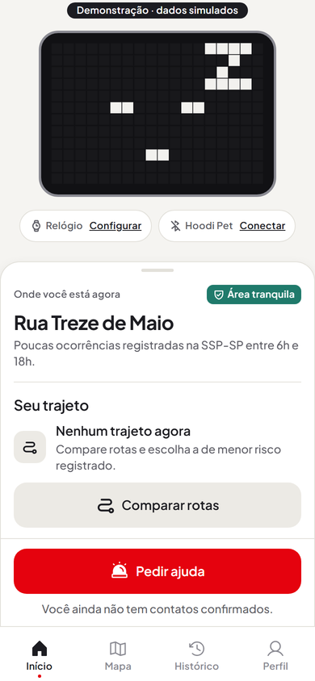 |  |  |  |
| **Mapa com o trajeto** | **Alerta de risco** | **Pedir ajuda** | **Pedido registrado** |
| 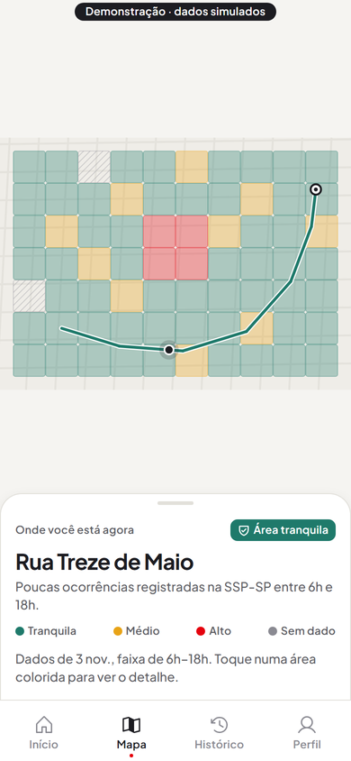 | 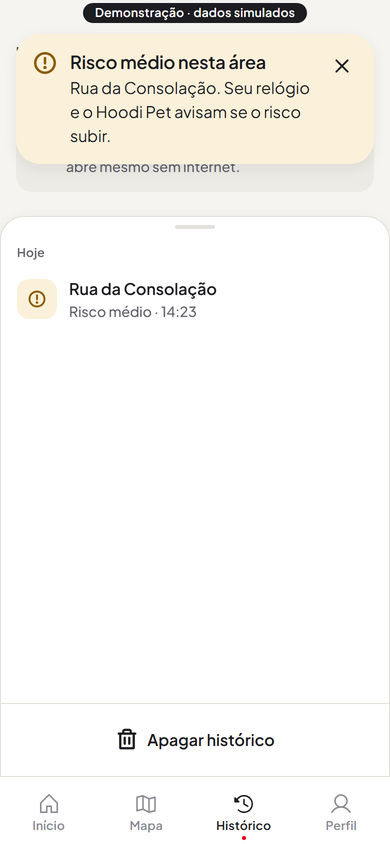 | 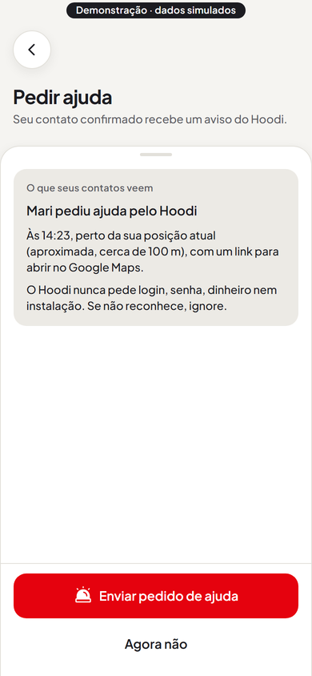 | 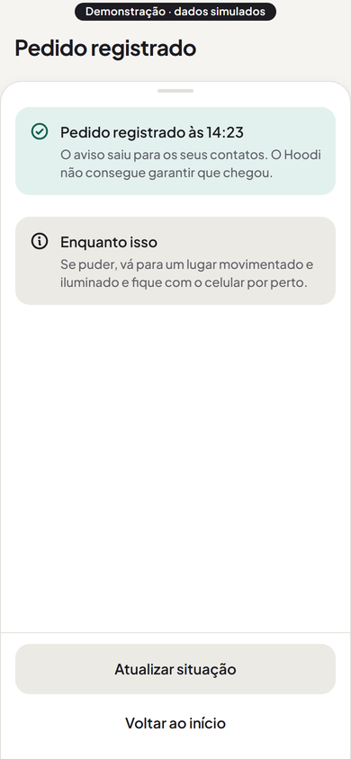 |
| **Entrar** | **Criar conta** | **Contatos** | **Perfil** |
| 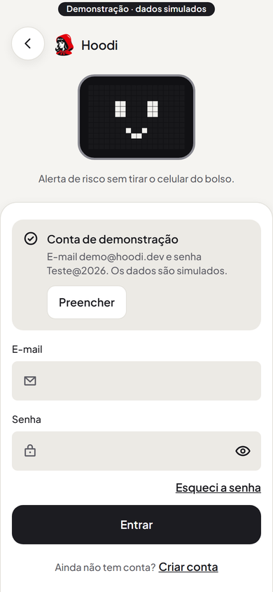 | 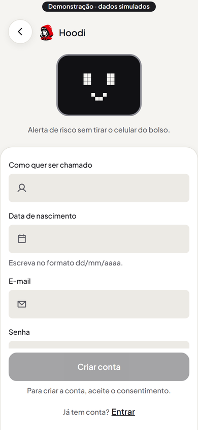 |  | 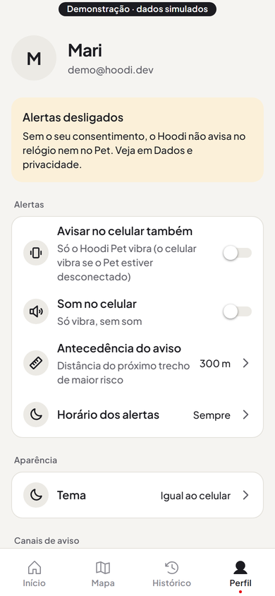 |
| **Abertura** | **Permissões** | **Relógio** | **Dados e privacidade** |
|  | 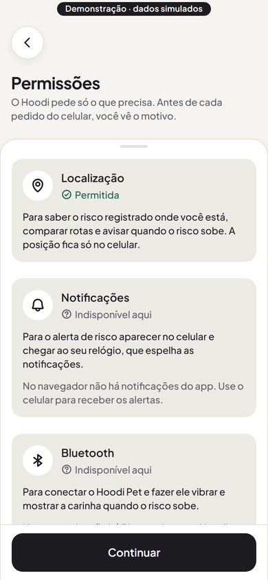 | 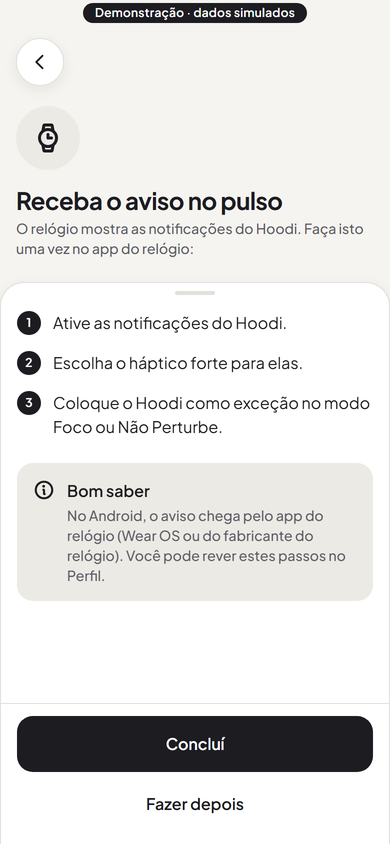 | 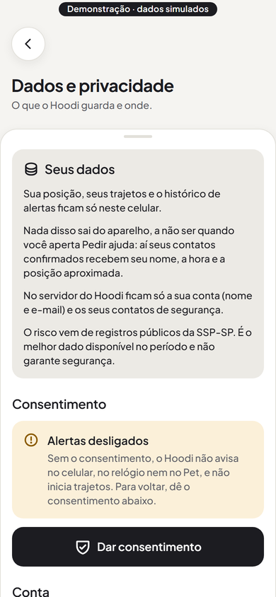 |

## Funcionalidades

Seguem as features do QA no Azure Boards (v2). Detalhes de cada uma em [docs/funcionalidades.md](docs/funcionalidades.md).

| Feature | O que a pessoa faz | Situação |
|---|---|---|
| **F01** Cadastro e acesso | Cria a conta (nome, nascimento, e-mail, senha, consentimento), confirma pelo link do e-mail, entra, recupera a senha | ✅ Ligado à API |
| **F02** Boas-vindas e permissões | Vê o motivo de cada permissão antes do pedido do sistema; recebe a sugestão do tema escuro à noite | ✅ |
| **F03** Mapa reduzido offline | Vê o risco onde está, das células em volta e do trajeto, mesmo sem internet | ✅ Aguardando a grade real da API |
| **F04** Comparar rotas | Compara a rota normal com a de menor risco registrado, com a diferença em minutos | ✅ Rotas no mock da API |
| **F05** Trajeto em andamento | Confere num relance o nível atual, o tempo até o destino e o próximo trecho de risco | ✅ Com o app aberto |
| **F06** Relógio e Hoodi Pet | Configura o relógio e pareia o Pet com o código do visor | ✅ Precisa de development build |
| **F07** Alerta de risco | Recebe o aviso na tela, no relógio e no Pet quando o risco sobe | ✅ |
| **F08** Perfil e privacidade | Ajusta os alertas, vê o que fica no aparelho, revoga o consentimento, exclui a conta | ✅ Ligado à API |
| **F09** Contatos e pedido de ajuda | Convida contatos de confiança e pede ajuda com a posição aproximada | ✅ Ligado à API |
| **F10** Histórico de alertas | Consulta os alertas recebidos, guardados só no aparelho | ✅ |

**Regras que valem no app todo:** cor nunca sozinha (todo nível tem cor, ícone e nome) · "Sem dado" nunca é tratado como área tranquila · nada de "rota segura" ou "tempo real" · posição, trajeto e histórico não saem do celular, exceto no Pedir ajuda · ações que apagam ou desligam algo pedem confirmação.

## Como rodar

Pré-requisitos: [Node.js](https://nodejs.org/) 20+ e o app **Expo Go** (SDK 58) no celular.

```bash
npm install
```

### 1. No celular, com o Expo Go

```bash
npm start
```

Leia o QR code com o Expo Go (Android) ou com a câmera (iPhone). Celular e computador na mesma rede Wi-Fi; se não conectar, use `npx expo start --tunnel`.

### 2. Com a API do Abner

Crie o arquivo `.env` na raiz com o IP do computador na rede (não `localhost`):

```
EXPO_PUBLIC_API_URL=http://IP-DO-PC:5000
EXPO_PUBLIC_MOCK_URL=http://IP-DO-PC:4010
```

Suba a API com `--Https:RedirectEnabled=false` (sem ele o celular não conecta) e o mock das rotas. Passo a passo em [docs/integracoes.md](docs/integracoes.md#rodar-com-a-api-local).

### 3. Modo demonstração no navegador

Para o vídeo e os prints, sem API, GPS ou Bluetooth, com **dados simulados** e o selo "Demonstração · dados simulados" na tela:

```bash
npx expo start --web --port 8081
```

Abra **http://localhost:8081/?demo=1** e entre com `demo@hoodi.dev` / `Teste@2026` (botão **Preencher**). Em Comparar rotas, **Iniciar trajeto** faz a posição andar sozinha pela rota. Detalhes em [docs/integracoes.md](docs/integracoes.md#modo-demonstração-no-navegador-vídeo-e-prints).

### 4. Development build (Bluetooth e push)

O Expo Go não tem Bluetooth nem push no Android. Para o Hoodi Pet: `eas init`, chave do Firebase e build do APK, em [docs/integracoes.md](docs/integracoes.md#development-build-bluetooth-e-push).

### Comandos úteis

| Comando | O que faz |
|---|---|
| `npm run typecheck` | Confere os tipos do TypeScript |
| `npm run lint` | Roda o ESLint |
| `npm run test:pet` | 19 testes das regras sem tela: protocolo do Pet, alerta, aviso antecipado e comparação de rotas |

## Tecnologias

| Para quê | Biblioteca |
|---|---|
| Base | Expo SDK 58 · React Native 0.88 · TypeScript (modo estrito) · Expo Router |
| Dados no aparelho | `expo-sqlite` (grade de risco, histórico, preferências) · `expo-secure-store` (sessão) |
| API | `fetch` com renovação automática do login ([`sessao.ts`](src/features/conta/sessao.ts)) |
| Mapa e posição | `react-native-maps` · `expo-location` |
| Avisos | `expo-notifications` (espelhada no relógio) · `react-native-ble-plx` (Hoodi Pet, protocolo v1) |
| Interface | Plus Jakarta Sans · Phosphor Icons · `react-native-svg` · Lottie · `@react-native-community/datetimepicker` |

## Documentação

| Documento | O que tem |
|---|---|
| [Funcionalidades](docs/funcionalidades.md) | Cada tela e feature (F01 a F10), com os critérios de aceite que atende |
| [Integrações](docs/integracoes.md) | API local, modo demonstração, grade de risco, protocolo Bluetooth do Pet e development build |
| [Design e acessibilidade](docs/design-e-acessibilidade.md) | Como o app segue o design system v3, ícone e splash, acessibilidade |
| [Para desenvolver](docs/desenvolvimento.md) | Estrutura de pastas, banco local e como contribuir |
| [prompts.md](prompts.md) | Registro do uso de IA (regra da GS) |

## Pendências

- **Grade de risco real:** a API ainda não publica a grade v0.6 (células H3, níveis 0 a 3). Até lá, o Mapa mostra "Dados de risco indisponíveis" (no modo demonstração, a grade simulada). Falta decidir o nome do nível 3.
- **Trajeto com a tela bloqueada (F05 CA3):** o acompanhamento roda com o app aberto; o segundo plano precisa de `expo-task-manager` e do development build.
- **Pressão longa no botão do Pet:** chega ao app, mas ainda não faz nada (pode virar o Pedir ajuda, se a equipe confirmar).
- **Design system:** a telinha do Pet no Início e os cards com borda e sombra sutil ainda precisam ser levados ao design system v3.
