# Design system e acessibilidade

Como o app segue o design system v3 do Hoodi, as decisões visuais da equipe e as regras de acessibilidade.

[← Voltar ao README](../README.md)

## Design system

O app segue o **design system v3** do hoodi. Os tokens estão em [`src/theme/tokens.ts`](../src/theme/tokens.ts), com os mesmos nomes do PDF (`papel`, `grafite`, `capuz`, `seguro`, `atencao`…), para facilitar a conferência.

Regras que o código já aplica:

- **Tema claro e escuro** seguindo o sistema do celular.
- **Vermelho é perigo:** o vermelho `capuz` aparece só no risco alto, na logo e no botão Pedir ajuda. O botão primário é grafite.
- **Cor nunca sozinha:** todo nível de risco tem cor, ícone e nome (Área tranquila, Risco médio, Risco alto, Sem dado).
- **Sem dado não é seguro:** "Sem dado" usa cinza e a carinha confusa, nunca verde nem sorriso, e diz isso em texto.
- **Linguagem honesta:** nada de "rota segura", "local seguro" ou "tempo real".
- **Ações que desligam algo pedem confirmação** (ex.: Encerrar trajeto).

Regras visuais combinadas pela equipe (além do v3):

- **"Hoodi" com H maiúsculo** em todos os textos do app (inclui "Hoodi Pet"). Identificadores técnicos continuam minúsculos: `hoodi://`, chaves de armazenamento e o nome que o Pet anuncia no Bluetooth (`hoodi Pet XXXX`, vem do firmware).

- **Ícones Phosphor** em vez de Lucide.
- **Sombra sutil e borda limpa** nos cards (token `sombra.suave` + borda de 1px em `linha`). **Nada de gradientes.**
- **Micro-interações com Lottie**, com animações aprovadas antes de entrar.
- **Sem título no topo das telas:** a barra de navegação já diz onde você está; telas fora das abas têm só o botão de voltar.

## Prints

No navegador, no [modo demonstração](../README.md#3-modo-demonstração-no-navegador) (dados simulados), em tamanho de celular.

| Início | Mapa | Comparar rotas | Em trajeto |
|:-:|:-:|:-:|:-:|
| 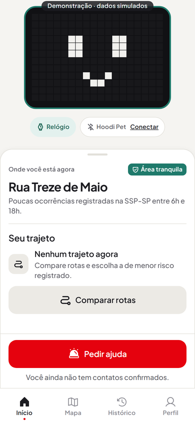 |  | 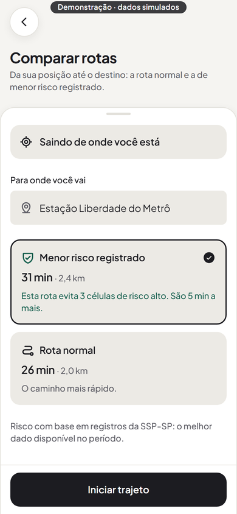 | 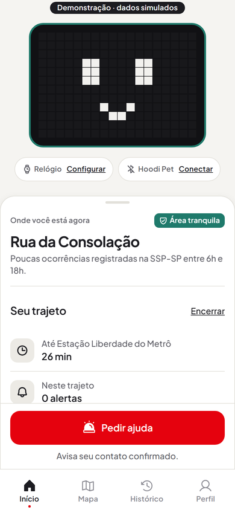 |
| **Mapa com o trajeto** | **Alerta de risco** | **Pedir ajuda** | **Pedido registrado** |
| 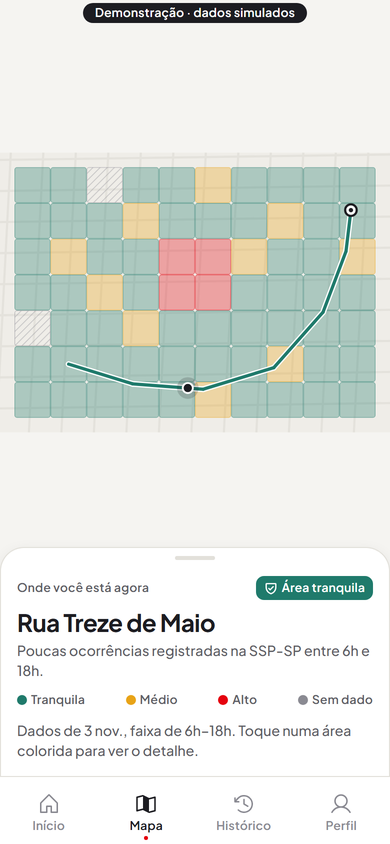 | 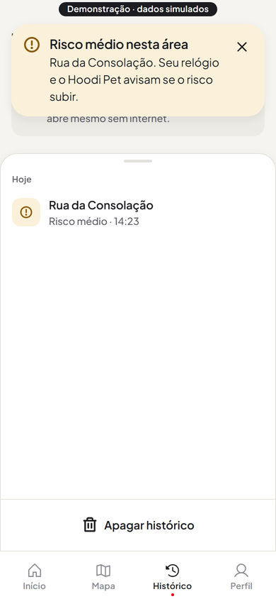 | 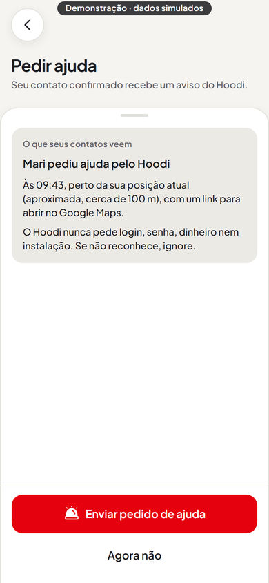 | 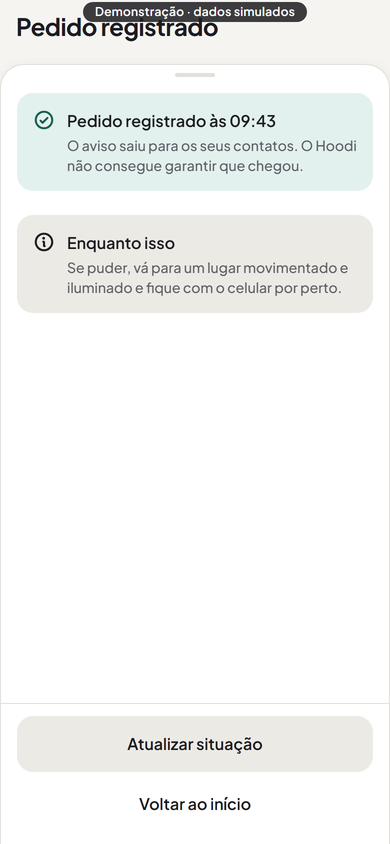 |
| **Entrar** | **Criar conta** | **Contatos** | **Perfil** |
| 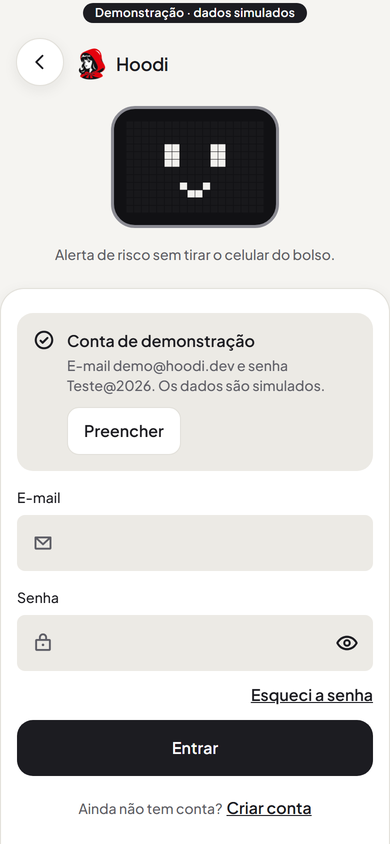 | 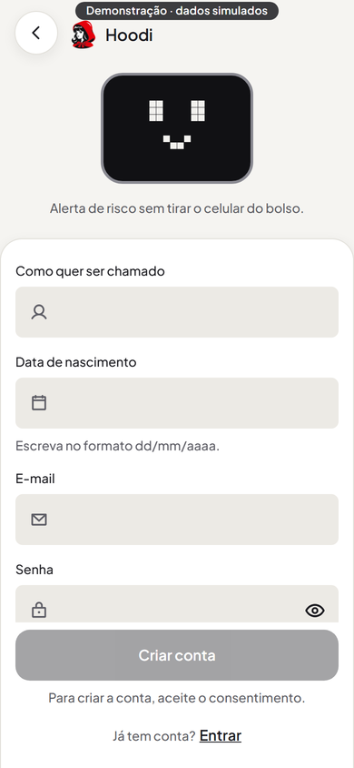 | 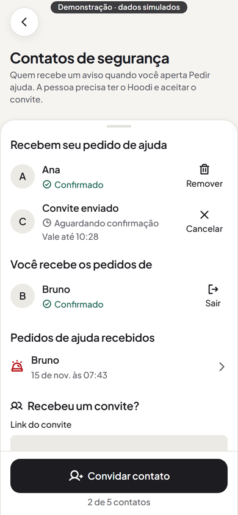 | 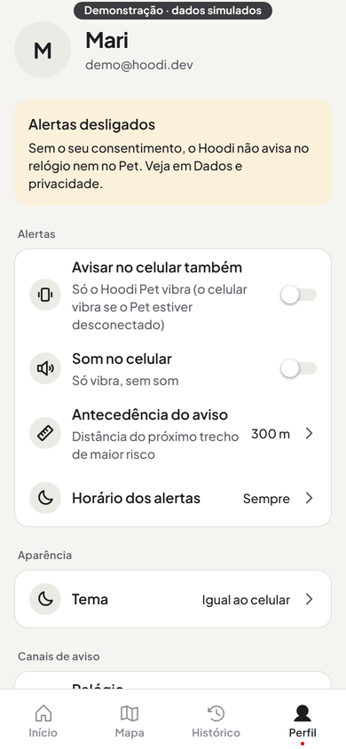 |
| **Abertura** | **Permissões** | **Relógio** | |
| 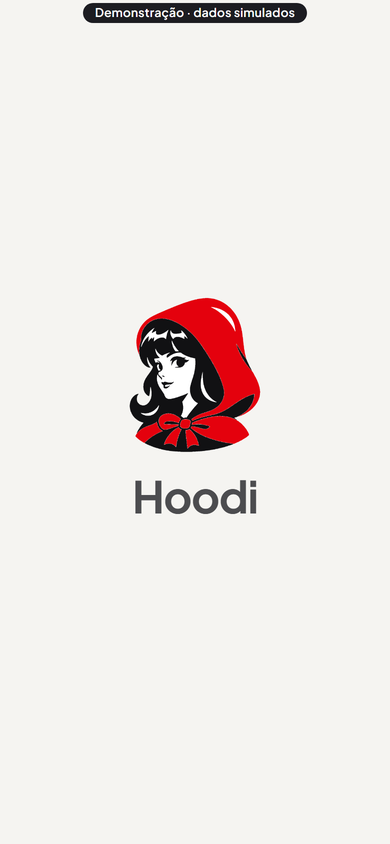 | 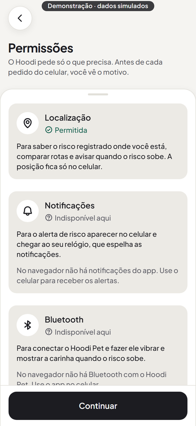 | 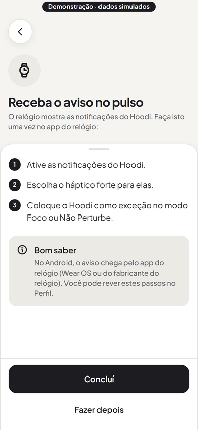 |  |

## Ícone e splash

Vêm do design system v3 (página "Logo e ícone do app"): a Chapeuzinho sobre o papel (`#F5F4F1`). No Android, ícone adaptativo (logo na zona segura, fundo papel) e versão monocromática para o ícone temático; no tema escuro, a splash usa a logo com contorno sobre `#121215`. Arquivos em `assets/images/` (`icon.png`, `android-icon-*.png`, `splash-icon*.png`, `favicon.png`).

## Acessibilidade

- Alvos de toque de pelo menos 48px; botões e barra de navegação com 56px.
- Texto corrido com 16px no mínimo, respeitando o tamanho de fonte do sistema (limitado a 1,6× para não quebrar o layout).
- Contraste mínimo de 4,5:1 em todo texto, nos dois temas (valores do design system).
- Rótulos e dicas para leitor de tela (TalkBack e VoiceOver) em botões, indicadores e cards. O status atual é anunciado pelo nome do nível, sem depender da cor (F05 CA5).
- Títulos marcados como cabeçalho para navegação por leitor de tela.
